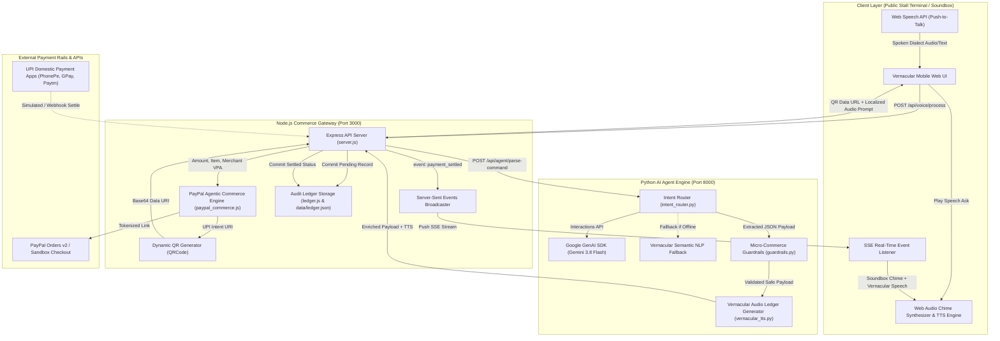
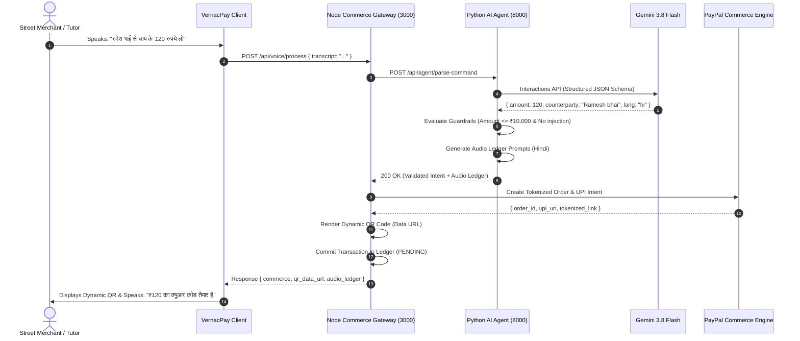
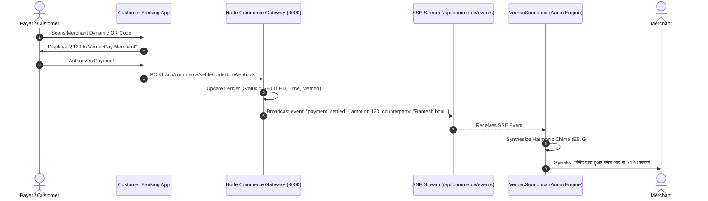

# 🏛️ System Architecture

## Project: VernacPay AI — Voice-Native, Vernacular Micro-Commerce Agent
**Architecture Version:** 1.0.0  
**Stack:** Python (FastAPI, Gemini 3.8 Flash) • Node.js (Express, PayPal Agentic Commerce) • Web Audio & Speech Client  

---

## 1. High-Level Architectural Topology

VernacPay AI uses an **air-gapped, dual-service architecture** that strictly decouples the non-deterministic Generative AI layer from the deterministic financial commerce and tokenization layer.

---

## 2. Sequence Diagrams

### 2.1 Voice-to-QR Generation Sequence

### 2.2 Settlement & Screen-Free Audio Ledger Sequence

---

## 3. Safety Architecture & Fund Isolation Model

> [!IMPORTANT]
> The primary vulnerability in AI-driven commerce is **prompt injection and unauthorized wallet draining**. VernacPay AI enforces architectural isolation.

### 3.1 AI Isolation Guarantees
1. **Zero Access to Private Keys / Accounts**: The AI Agent (Gemini 3.8 Flash) operates in a sandboxed, read-only analytical mode. It cannot initiate wire transfers, query bank account numbers, or alter payout destinations.
2. **Deterministic Settlement Boundary**: The merchant's settlement VPA (`vernacpay.merchant@icici`) and PayPal receiver account are immutable server-side environment variables (`.env`). The LLM cannot modify the beneficiary.
3. **Pre-Defined Micro-Commerce Caps**:
   - Hard upper bound: **₹10,000 INR** ($150 USD).
   - Minimum bound: **₹1.00 INR**.
   - If an amount exceeds ₹10,000, `guardrails.py` halts token generation with status `EXCEEDS_MICRO_LIMIT` and produces a security rejection audio prompt.
4. **Prompt Injection Sanitization**: Input strings are scrubbed for instruction overrides (e.g., *"ignore previous instructions"*, *"override limit"*, *"send to external wallet"*).

---

## 4. Component Responsibility Matrix

| Component | File Path | Language | Primary Responsibilities |
|---|---|---|---|
| **API Entry & UI Server** | `node-commerce/server.js` | JavaScript (Node.js) | Serves front-end, orchestrates requests, manages SSE connections, routes payments. |
| **Commerce & QR Engine** | `node-commerce/paypal_commerce.js` | JavaScript (Node.js) | PayPal Orders v2 tokenization, UPI deep link generation, QR Code rasterization. |
| **Audit Ledger Store** | `node-commerce/ledger.js` | JavaScript (Node.js) | In-memory and disk persistence (`data/ledger.json`), daily revenue reconciliation. |
| **AI Agent REST API** | `python-agent/app.py` | Python (FastAPI) | Exposes `/api/agent/parse-command`, health metrics, sample scenario registry. |
| **Intent Router** | `python-agent/intent_router.py` | Python | Gemini 3.8 Flash structured output parsing, vernacular heuristic fallback, entity extraction. |
| **Financial Guardrails** | `python-agent/guardrails.py` | Python | Monetary boundary checking, prompt injection defense, AI quarantine verification. |
| **Audio Prompt Generator** | `python-agent/vernacular_tts.py` | Python | Localized dialect string generation for Hindi, Telugu, Urdu, Tamil, Bengali, English. |
| **Soundbox Audio Synthesizer**| `public/audio-chimes.js` | JavaScript (Browser) | Web Audio harmonic payment chimes, Web Speech regional dialect playback. |
| **Client Orchestration** | `public/app.js` | JavaScript (Browser) | Web Speech API speech-to-text, SSE listener, dynamic QR display, simulator trigger. |

---

## 5. Network Interfaces & Ports

- **Port 3000 (`http://localhost:3000`)**: Node.js Commerce Gateway, static UI, and SSE streams.
- **Port 8000 (`http://127.0.0.1:8000`)**: Python AI Agent Engine (internal loopback only).
- **Outbound HTTPS (443)**:
  - `https://generativelanguage.googleapis.com` (Gemini 3.8 Flash)
  - `https://api-m.sandbox.paypal.com` (PayPal Sandbox Orders API)
