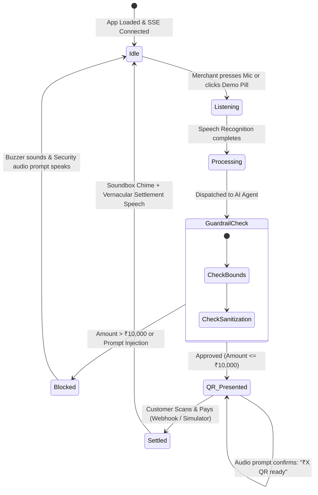

# 🎨 Design & Experience Specification

## Project: VernacPay AI — Voice-Native, Vernacular Micro-Commerce
**Design Philosophy:** "Sunlight-Ready, Voice-Native, Zero UI Literacy"  
**Version:** 1.0.0  

---

## 1. Core Design Philosophy

Traditional financial technology applications assume user literacy, English fluency, and indoor smartphone ergonomics. Street vendors and informal workers, however, operate in **harsh sunlight, loud street noise, and fast-paced environments with hands often occupied or soiled**.

VernacPay AI adheres to three core design pillars:
1. **Voice as the Primary Input**: Speech is the main driver; visual screens serve as secondary confirmation and customer-facing QR presentation.
2. **Sunlight & Outdoor Visibility**: High-contrast OLED dark themes with vivid, luminous accents (emerald, amber, cyan) that remain readable even under direct midday sun.
3. **Screen-Free Reconciliation**: Merchants must never be forced to unlock or stare at a smartphone screen to verify payment—the audio soundbox provides 100% verbal clarity.

---

## 2. Visual Design System

### 2.1 Color Palette & Tokens

```css
:root {
    /* Backgrounds: Deep OLED Blacks to eliminate glare */
    --bg-main: #090d16;          /* Midnight Stall Black */
    --bg-card: #111827;          /* Slate Surface */
    --bg-card-hover: #1f2937;    /* Elevated Surface */
    --border-color: #374151;     /* Contrast Divider */

    /* Semantic Accents: High Luminescence */
    --primary-emerald: #10b981;  /* Success / QR Active (#34d399 glow) */
    --primary-amber: #f59e0b;    /* Caution / Pending Customer Action */
    --primary-blue: #3b82f6;     /* AI Isolation & Tokenization */
    --danger-red: #ef4444;       /* Guardrail Security Violation */

    /* Typography */
    --text-main: #f9fafb;        /* Pure White (18:1 contrast on dark) */
    --text-muted: #9ca3af;       /* Secondary Guidance */
    --text-dim: #6b7280;         /* Metadata & Timestamps */

    /* Soundbox Hardware Unit */
    --soundbox-blue: #0284c7;    /* Classic Soundbox Enclosure */
    --soundbox-glow: rgba(2, 132, 199, 0.35);
}
```

### 2.2 Typography & Multi-Script Stack
The typography must render vernacular scripts flawlessly without tofu characters or layout shifts:

```css
font-family: system-ui, -apple-system, BlinkMacSystemFont, 'Segoe UI',
             'Noto Sans', 'Noto Sans Devanagari', 'Noto Sans Telugu',
             'Noto Nastaliq Urdu', 'Noto Sans Tamil', 'Noto Sans Bengali', sans-serif;
```

---

## 3. Physical & Tactile UI Ergonomics

### 3.1 Oversized Push-to-Talk Microphone Button
- **Dimensions:** `110px x 110px` circular tactile button centered in a `140px` flex container.
- **Elevation & Depth:** Graded gradient (`#10b981` to `#059669`) with a `4px solid #34d399` rim.
- **Rest State Glow:** `box-shadow: 0 0 35px rgba(16, 185, 129, 0.35)`.
- **Listening State:** Transforms into a pulsing crimson hue (`#ef4444` to `#b91c1c`) with concentric expanding ripple waves (`animation: rippleWave 1.6s infinite ease-out`).
- **Touch Target:** Well above the minimum 48px touch target to accommodate one-handed operation or thumb presses with wet or gloved hands.

```
       [ Concentric Ripple Wave ]
             ┌───────────┐
          ╭──│  ( • )    │──╮
         │   │   🎙️      │   │  <-- 110px Push-to-Talk Button
          ╰──│           │──╯
             └───────────┘
```

### 3.2 Vernacular Dialect Chips
- Rounded pill buttons with national flags and native scripts:
  - 🇮🇳 `हिन्दी (Hindi)`
  - 🇮🇳 `తెలుగు (Telugu)`
  - 🇵🇰 `اردو (Urdu)`
  - 🇮🇳 `தமிழ் (Tamil)`
  - 🇮🇳 `বাংলা (Bengali)`
  - 🌐 `English (India)`
- Active state: Emerald background (`#10b981`), bold text, and emerald border.

---

## 4. VernacSoundbox 2.0 Acoustic Design

### 4.1 Psychoacoustics of Market Soundboxes
In a noisy market (> 75 dB ambient volume), plain synthetic speech gets swallowed by traffic and crowd noise. The VernacSoundbox 2.0 utilizes a **two-phase acoustic sequence**:

1. **Phase 1: Acoustic Priming (Harmonic Chimes)**
   - Synthesizes 4 pure harmonic tones using Web Audio API oscillators:
     - `E5` (659.25 Hz)
     - `G#5` (830.61 Hz)
     - `B5` (987.77 Hz)
     - `E6` (1318.51 Hz)
   - Duration: 480ms with exponential decay.
   - Purpose: Pierces background noise and causes the vendor to instinctively orient toward the speaker.

2. **Phase 2: Vernacular Verbal Ledger**
   - Pauses for 70ms after the chime, then speaks the formatted sentence at `0.95x` rate.
   - Uses localized terminology (*"पेमेंट प्राप्त हुआ! रमेश भाई से ₹120 सफल"*).

### 4.2 Visual Hardware Simulation
- The UI includes an animated hardware soundbox unit with:
  - Cyan LED power status dot.
  - Realistic perforated speaker grill pattern (`radial-gradient` dots).
  - Physical bounce keyframes (`@keyframes speakerBounce`) simulating speaker cone excursion during audio playback.

---

## 5. Interaction State Machine



---

## 6. Accessibility & Inclusivity (A11y)

- **Zero Reading Requirement:** A completely illiterate vendor can operate the entire payment cycle purely through voice prompts and audio confirmations.
- **Color Contrast:** All text elements exceed the WCAG 2.2 AAA standard (minimum 7:1 contrast ratio; white text on midnight dark background reaches 18:1).
- **Tactile Sound Control:** A dedicated Sound ON/OFF mute button ensures vendors can silence the device in places of worship or quiet settings.
